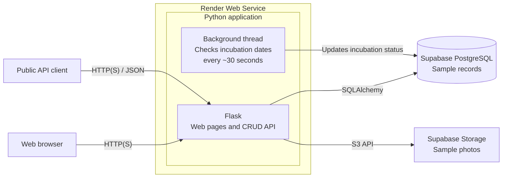

## Architektūra



## Public API

- `GET /api/samples` – sample list.
- `GET /api/samples/<id>` – one sample.
- `POST /api/samples` – create sample.
- `PUT /api/samples/<id>` – update sample.
- `DELETE /api/samples/<id>` – delete sample.

POST ir PUT JSON pavyzdys:

```json
{
  "name": "API demonstracija A",
  "colony_count": 12,
  "temperature": 25.5,
  "is_pathogenic": false,
  "incubation_started_on": "2026-10-05",
  "incubation_ends_on": "2026-10-20",
  "incubation_status": "Incubating"
}
```

curl -i -X POST 'https://petri-log.onrender.com/api/samples' \
  -H 'Content-Type: application/json' \
  -d '{
    "name": "API demonstracija A",
    "colony_count": 12,
    "temperature": 25.5,
    "is_pathogenic": false,
    "incubation_started_on": "2026-10-05",
    "incubation_ends_on": "2026-10-20",
    "incubation_status": "Incubating"
  }'

curl -i -X PUT 'https://petri-log.onrender.com/api/samples/xxxxx' \
  -H 'Content-Type: application/json' \
  -d '{
    "name": "API demonstracija A",
    "colony_count": 12,
    "temperature": 25.5,
    "is_pathogenic": true,
    "incubation_started_on": "2026-10-05",
    "incubation_ends_on": "2026-10-20",
    "incubation_status": "Incubating"
  }'
